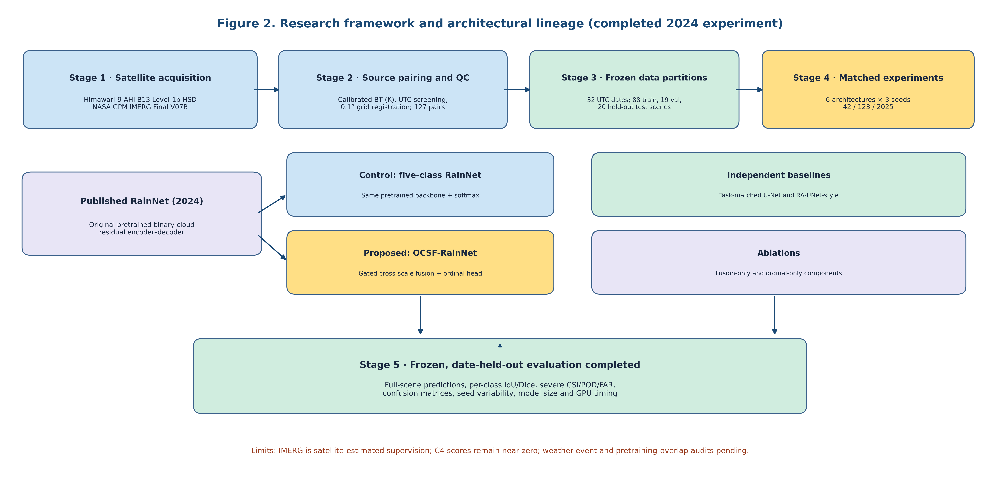

# OCSF-RainNet

**Ordinal Cross-Scale Fusion for IMERG-Supervised Rainfall Intensity Segmentation from Himawari Imagery**

An experimental research repository supporting a manuscript in preparation for [*SN Computer Science* (Springer Nature)](https://link.springer.com/journal/42979/submission-guidelines). The project adapts the published residual RainNet architecture (Windarto et al., 2024) to **contemporaneous, five-class IMERG-supervised rainfall-intensity segmentation**, with context-gated cross-scale fusion and an ordinal cumulative-exceedance head.

> **Status — 22 November 2026:** 127 timestamp-matched calibrated Himawari-9 AHI B13 / IMERG Final V07B pairs across 32 UTC dates; 18/18 completed Kaggle experiments (six models × seeds 42, 123, 2025). Checkpoints, predictions-derived metrics and confusion matrices were independently cross-checked against archived files. This is a **research result**, not an operational rainfall warning system. A date-disjoint split does not, by itself, certify meteorological-event independence.

## Experimental setup

| Item | Reproducibility specification |
|---|---|
| Himawari input | Calibrated Himawari-9 AHI Band 13, original Level-1b HSD, brightness temperature (K) |
| Supervisory target | NASA GPM IMERG Final V07B, satellite-estimated precipitation rate in mm h⁻¹ |
| Task | Contemporaneous five-class semantic segmentation, **not future rainfall forecasting** |
| Grid | IMERG 0.1°; image/mask 185 × 460; full-scene inference padded to 192 × 464 |
| Partition | Train 88 scenes/22 dates; validation 19/5; testing 20/5 |
| Controlled models | Multiclass RainNet; fusion-only; ordinal-only; full OCSF-RainNet; U-Net; RA-UNet-style |
| Seeds | 42, 123, 2025 |
| Training budget | Up to 25 epochs, batch 2, 128 × 128 crops, early stopping patience 4 |
| Loss | Masked class-weighted cross entropy + 0.12 normalized ordinal-severity distance |
| Experiment location | GPU on Kaggle account `agusperdana`; not the laptop GPU |

Class boundaries are **C0: 0–<1**, **C1: 1–<5**, **C2: 5–<10**, **C3: 10–20 inclusive**, **C4: >20 mm h⁻¹**, with missing/invalid values ignored (255). These research thresholds are not official BMKG warning thresholds.

## Experimental results

**Mean ± standard deviation** over three seeds using identical five held-out UTC dates:

| Model | Parameters | Macro IoU | Macro Dice | Severe CSI |
|---|---:|---:|---:|---:|
| Multiclass RainNet | 142,637 | 0.2665 ± 0.0213 | 0.3271 ± 0.0393 | 0.0305 |
| Fusion-only | 148,234 | 0.2701 ± 0.0081 | 0.3350 ± 0.0143 | 0.0185 |
| Ordinal-only | 142,632 | 0.2691 ± 0.0088 | 0.3331 ± 0.0142 | 0.0133 |
| **OCSF-RainNet** | **148,217** | **0.2750 ± 0.0014** | **0.3450 ± 0.0041** | **0.0537** |
| U-Net | 485,853 | 0.2685 ± 0.0011 | 0.3308 ± 0.0022 | 0.0000 |
| RA-UNet-style | 508,249 | 0.2648 ± 0.0096 | 0.3228 ± 0.0164 | 0.0027 |

These are **agreements with IMERG satellite estimates, not independently observed surface rainfall**. The highest *mean* metrics are obtained by OCSF-RainNet in this experiment, but the proposed architecture is **not superior at every seed**. Its macro IoU is lower than RainNet for seed 2025. The rarest rainfall class C4 remains essentially undetected (mean IoU approximately **0.00027** even for OCSF-RainNet). Do not overstate operational skill, robust extreme-rain detection or statistical significance.

## Figures and research framework

The updated figures represent the **actual completed calibrated experiment**, rather than the archived one-scene pilot.

See [figure and table index](docs/FIGURES_AND_TABLES_INDEX.md) for the complete list, including high-resolution PNG/SVG sources, 18 confusion matrices, 18 learning curves and original pilot figures clearly separated as historical artwork.

## Repository organization

| Directory | Content |
|---|---|
| [`src/`](src) | Versioned model graph, controlled training protocol, AHI/IMERG preprocessing and evaluation scripts |
| [`notebooks/`](notebooks) | Executed Kaggle *source notebooks* (Master16 plus two individual seed-42 runs) and diagnostic notebooks |
| [`figures/`](figures) | Revised Figure 1–3, analysis plots, all confusion matrices and learning curves |
| [`tables/`](tables) | Published evidence tables, 18-run matrices and profiling CSVs |
| [`metadata/`](metadata) | Source scene inventory, UTC-date splits, audit results and SHA-256 manifests |
| [`results/runs/`](results/runs) | Per-run held-out scores, per-scene statistics, confusion matrices, training histories |
| [`checkpoints/`](checkpoints) | Saved best and last weights for 18 model/seed runs |
| [`manuscript/`](manuscript) | **Archived pre-experiment working DOCX/PDF**, references; not the final journal manuscript |
| [`docs/`](docs) | Springer checklist, methodological details, licensing and availability notices |

## Reproduction

See [reproduction protocol](docs/REPRODUCE.md) and the executable notebook definitions in `notebooks/kaggle/`. The project requires a verified copy of the source satellite data and the frozen partitions. The 18 run summaries can be inspected directly in [Table 6 (CSV)](tables/Table_06_All_18_Runs.csv), [Table 5 (mean/SD)](tables/Table_05_Mean_SD_6_Models.csv), and [independent run audit](metadata/18_run_independent_audit.json) without GPU training.

The upstream inputs are:
- **IMERG Final V07B:** [NASA GES DISC dataset and DOI](https://doi.org/10.5067/GPM/IMERG/3B-HH/07)
- **Himawari-9 AHI Level-1b:** [NOAA Himawari-9 open data](https://registry.opendata.aws/noaa-himawari/)
- **Original RainNet:** Windarto, Yuhandri & Bukhori (2024), [DOI: 10.24507/icicel.18.04.313](https://doi.org/10.24507/icicel.18.04.313)
- **Processed dataset:** [private Kaggle dataset `agusperdana/ocsf-rainnet-calibrated-2024`](https://www.kaggle.com/datasets/agusperdana/ocsf-rainnet-calibrated-2024)

**Data publication boundary:** raw NOAA/JMA satellite scenes, original NASA IMERG files, private paired NPZ datasets, authentication credentials and the 18 large per-scene prediction ZIP archives are **not published in this public GitHub repository**. Data identifiers, processing source, checksums and source-to-target manifests are provided. Availability of the private processed dataset must be arranged with the responsible author and described transparently to the journal.

## Springer manuscript status

The archived original DOCX **preserves its native Mendeley/Word citation fields**. It predates the expanded 127-pair HSD-based experiment and contains outdated prospective language and some pilot diagrams. **Do not submit it without revision.** The repository includes [submission corrections and limitations](docs/SPRINGER_SUBMISSION_STATUS.md), including updates required to the Dataset, Research Framework, Architecture, Results, Discussion, and manuscript declarations.

The full train/validation/test splits have been fixed by UTC date, but the **independence of meteorological events and potential overlap with the prior RainNet pretraining dataset remain to be audited**. Inference profiling measures computational cost only and does not validate rainfall physics.

## Availability, attribution and licensing

See [data/code availability statements](docs/DATA_AND_CODE_AVAILABILITY.md), [copyright and distribution notice](LICENSE_NOTICE.md), and [citation metadata](CITATION.cff). A software reuse license has not yet been granted by the authors. Publishing the repository does not mean the manuscript has been accepted or published by Springer Nature.
