# OCSF-RainNet

**Ordinal Cross-Scale Fusion for IMERG-Supervised Rainfall Intensity Segmentation from Himawari Imagery**

Reproducibility package supporting a manuscript intended for *SN Computer Science* (Springer Nature). **127 calibrated Himawari–IMERG pairs, 32 UTC dates, and 18/18 finished and audited Kaggle model×seed experiments.**

> These are comparisons against NASA GPM IMERG Final V07B **satellite-estimated rainfall labels**, not independent BMKG observations. The C4 very-heavy class remains nearly undetected; meteorological-event independence and overlap with the RainNet pretraining collection have not been fully validated.

## Figures 1–3: exact images from the attached Springer manuscript

The following **three unchanged original PNGs** are byte-for-byte identical to the figures embedded in the attached Word manuscript. Their checksums are in [source figure verification](metadata/MANUSCRIPT_FIGURE_VERIFICATION.json). The images were not redesigned or substituted.

### Figure 1. Dataset characterization of the 7 January 2024 pilot

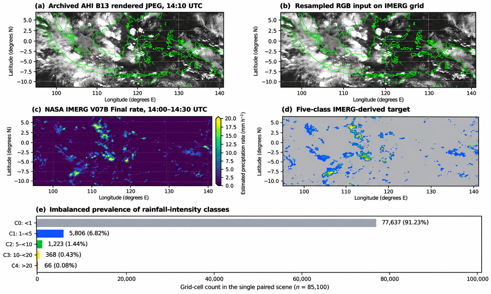

The original pilot illustrates the archived JPEG, IMERG rate, thresholded five-class target, and class distribution; this is not the input dataset used by the later full calibrated experiment.

### Figure 2. Research framework and novelty development from the manuscript

The dashed planned/not-trained stages show the **historical draft status**. They have since been completed in 18 documented Kaggle runs. The original figure is deliberately preserved unchanged.

### Figure 3. Original OCSF-RainNet architecture and multiclass RainNet baseline

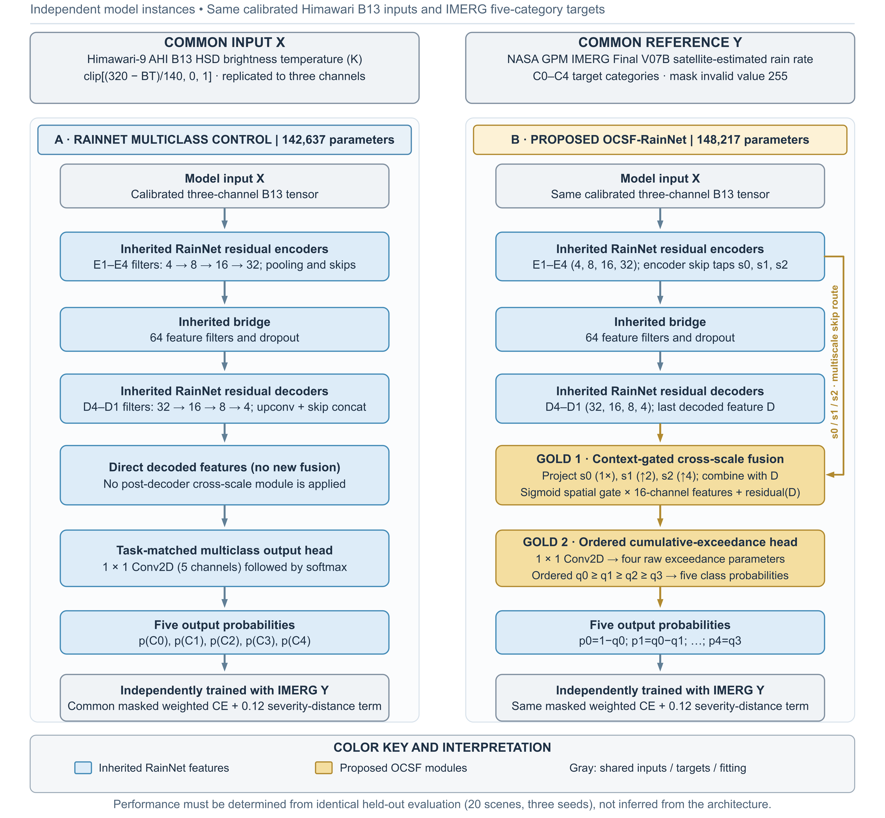

The architecture is displayed exactly as in the paper: separate RainNet control and proposed output branches with the common NASA IMERG V07B target. Its pictured RGB/JPEG input is a historical pilot; the actual full experiment uses calibrated HSD B13 brightness-temperature inputs.

**Additional, post-experiment methodology figures (not substituted above):** [calibrated HSD representative scene](figures/methods/Figure_1_Calibrated_2024_Representative_Scene.png), [revised framework](figures/methods/Figure_2_Research_Framework_Updated.png), [revised method architecture](figures/methods/Figure_3_Model_Architecture_Updated.png).

## New held-out image evidence (manuscript Figures 10–14)

The revised manuscript and all figures below use actual seed-42 held-out predictions from the 18 Kaggle experiments. The Figure 1–3 images above are preserved unchanged.

**[Download latest complete Springer manuscript (DOCX)](manuscript/current_revision/OCSF_RainNet_Springer_Qualitative_Revision_2026-11-22.docx)**

- [Figure 11: all-model failure](figures/manuscript_qualitative/Figure_11_Qualitative_failure.png)
- [Figure 12: fusion-only counterexample](figures/manuscript_qualitative/Figure_12_Qualitative_counterexample.png)
- [Figure 13: true/false positive and missed severe pixels](figures/manuscript_qualitative/Figure_13_Severe_Rain_TP_FP_FN.png)
- [Figure 14: ordinal-distance error maps](figures/manuscript_qualitative/Figure_14_Ordinal_Distance_Error_Maps.png)
- [Table 11: 12 selected-ROI confusion rows](tables/Table_11_Qualitative_ROI_Severe_Error.csv)
- [Table 12: the 12 matched full-scene evaluation rows](tables/Table_12_Matched_Full_Scene_Severe_Metrics.csv)
- [Provenance manifest, case selection, and limitations](docs/QUALITATIVE_TEST_PREDICTIONS.md)

The three examples were selected post hoc, not randomly: a local gain (2024-12-11 20:10 UTC), a complete severe miss (2024-06-03 14:10 UTC), and a fusion-only advantage (2024-08-11 02:10 UTC). All comparisons use the same 64x96-pixel ROI per scene, seed 42, and original IMERG target. Quantitative claims remain based on all held-out scenes and all three seeds. No independent BMKG rain-gauge or radar truth was used.

## RQ1–RQ3: experimentally supported answers

The manuscript Introduction asks (RQ1) whether gated cross-scale fusion improves localized high-intensity regions; (RQ2) whether an ordinal head reduces intensity-severity classification errors; and (RQ3) whether fusion plus ordinal modeling gives consistent benefits without excessive complexity. Comparisons below use the same train/validation/test dates and seeds **42, 123, 2025**.

| RQ | Component vs. RainNet control | Δ mean Macro IoU | Δ mean severe CSI | Δ mean ordinal distance on true C3/C4 cells (lower better) | Improved Macro IoU seeds | Evidence-based verdict |
|---|---|---:|---:|---:|---:|---|
| RQ1 | Fusion-only | +0.0036 | -0.0121 | -0.0791 | 1/3 | Small aggregate gain, **no evidence of better severe-area detection** |
| RQ2 | Ordinal-only | +0.0026 | -0.0172 | -0.2043 | 1/3 | Severe-label distance improves, **severe CSI worsens** |
| RQ3 | OCSF-RainNet | +0.0085 | +0.0231 | -0.1798 | 2/3 | Best mean tested overlap/CSI, **not consistent at all seeds; higher latency** |

The ordinal-distance metrics were **computed from the actual 5×5 test confusion matrices** using mean absolute difference between true/predicted ordinal class indices; the severe-only metric uses true C3/C4 cells, not just correctly detected cells. [Metric definitions and data lineage](metadata/RQ_EVIDENCE_PROVENANCE.json).

### RQ1 — Fusion and localized heavy-rain regions

- **Fusion-only vs RainNet:** Macro IoU **0.2665 → 0.2701**, Macro Dice **0.3271 → 0.3350**. However, severe CSI **0.0305 → 0.0185**, C3 IoU **0.0251 → 0.0145**, and C4 IoU remains **0**.
- Only **1/3 seeds** has higher Macro IoU. Thus a small aggregate overlap improvement **does not establish stronger localized severe-rain segmentation**.
- Inspect [Figure 5](figures/results/Figure_5_Macro_IoU_3_Seeds.png), [Figure 6](figures/results/Figure_6_Severe_CSI_3_Seeds.png), [Figure 9](figures/results/Figure_9_Per_Class_IoU.png) and [paired-seed contrasts](tables/Table_11_RQ_Paired_Seed_Deltas.csv).

### RQ2 — Ordinal head and rainfall-severity errors

- **Ordinal-only vs RainNet:** all-valid-cell mean ordinal class-distance error **0.1080 → 0.1077** and error on true C3/C4 cells **1.8141 → 1.6098**. This is evidence for lower **severity-distance error** under that metric.
- Nevertheless, severe CSI **0.0305 → 0.0133** and C3 IoU **0.0251 → 0.0103**; C4 IoU stays **0**. A better ordinal-distance metric did **not** yield better heavy-rain detection.
- The ordinal head and shared loss were tested; a separate **loss-only ablation** was not performed. See [Figure 10](figures/results/Figure_10_Ordinal_MAE_All_Classes.png), [Figure 11](figures/results/Figure_11_Ordinal_MAE_True_Severe.png) and [Table 8](tables/Table_08_Ordinal_Distance_Errors_18_Runs.csv).

### RQ3 — Combined model: gain, stability and computational trade-off

- **OCSF-RainNet vs RainNet:** mean Macro IoU **0.2665 → 0.2750**, Macro Dice **0.3271 → 0.3450**, severe CSI **0.0305 → 0.0537**, and C3 IoU **0.0251 → 0.0390**.
- The mean gains are **not uniform**: only **2/3 seeds** improve Macro IoU and severe CSI, and C4 IoU remains just **0.00027** on average.
- Parameters rise **142,637 → 148,217** (**+3.91%**). Diagnostic padded-scene GPU median inference time rises **54.86 → 64.12 ms** (**+16.87%**), and TensorFlow allocator peak rises **13.96 → 43.89 MiB**.
- **Verdict:** the combined method leads on the selected **mean** metrics but cannot yet support consistent generalized intense-rain detection or unconditional efficiency. GPU profiling used **untrained heads**, not a deployed trained-model benchmark.
- Inspect [Figure 7](figures/results/Figure_7_Seed_Comparison_Macro_IoU.png), [Figure 8](figures/results/Figure_8_GPU_Inference_Latency.png), [Figure 12](figures/results/Figure_12_RQ_Seedwise_Delta_Macro_IoU.png) and [full RQ contrast tables](tables/Table_13_RQ_Summary_Contrasts.csv).

## Main experimental tables

### Table 3 — Operational IMERG-derived categories

| Class | Threshold (mm h⁻¹) | Interpretation |
|---|---|---|
| C0 | 0 <= r < 1 | No or very light estimated precipitation |
| C1 | 1 <= r < 5 | Light |
| C2 | 5 <= r < 10 | Moderate |
| C3 | 10 <= r <= 20 | Heavy |
| C4 | r > 20 | Very heavy |
| 255 | invalid / missing | Excluded from loss and metrics |

### Table 4 — Architectural parameter inventory

| Model | Parameters | Role |
|---|---:|---|
| Original RainNet binary | 142,617 | Pretraining ancestor |
| plain | 142,637 | Five-class control |
| fusion | 148,234 | Fusion-only ablation |
| ordinal | 142,632 | Ordinal-only ablation |
| proposed | 148,217 | OCSF-RainNet |
| unet | 485,853 | External U-Net |
| raunet | 508,249 | RA-UNet-style |

### Table 5 — Held-out comparative results (mean ± sample SD, three seeds)

| Model | Macro IoU | Macro Dice | Severe CSI | C3 IoU | C4 IoU |
|---|---:|---:|---:|---:|---:|
| RainNet | 0.2665 ± 0.0213 | 0.3271 ± 0.0393 | 0.0305 ± 0.0529 | 0.0251 ± 0.0434 | 0.0000 ± 0.0000 |
| Fusion-only | 0.2701 ± 0.0081 | 0.3350 ± 0.0143 | 0.0185 ± 0.0290 | 0.0145 ± 0.0233 | 0.0000 ± 0.0000 |
| Ordinal-only | 0.2691 ± 0.0088 | 0.3331 ± 0.0142 | 0.0133 ± 0.0231 | 0.0103 ± 0.0178 | 0.0000 ± 0.0000 |
| OCSF-RainNet | 0.2750 ± 0.0014 | 0.3450 ± 0.0041 | 0.0537 ± 0.0148 | 0.0390 ± 0.0107 | 0.0003 ± 0.0005 |
| U-Net | 0.2685 ± 0.0011 | 0.3308 ± 0.0022 | 0.0000 ± 0.0000 | 0.0000 ± 0.0000 | 0.0000 ± 0.0000 |
| RA-UNet-style | 0.2648 ± 0.0096 | 0.3228 ± 0.0164 | 0.0027 ± 0.0027 | 0.0019 ± 0.0020 | 0.0000 ± 0.0000 |

### Table 6 — All 18 Kaggle training/evaluation runs

| Model | Seed | Best epoch | Macro IoU | Macro Dice | Severe CSI | C3 IoU | C4 IoU |
|---|---:|---:|---:|---:|---:|---:|---:|
| RainNet | 42 | 24 | 0.2435 | 0.2846 | 0.0000 | 0.0000 | 0.0000 |
| RainNet | 123 | 25 | 0.2702 | 0.3349 | 0.0000 | 0.0000 | 0.0000 |
| RainNet | 2025 | 25 | 0.2857 | 0.3620 | 0.0916 | 0.0752 | 0.0000 |
| Fusion-only | 42 | 19 | 0.2787 | 0.3508 | 0.0519 | 0.0414 | 0.0000 |
| Fusion-only | 123 | 4 | 0.2627 | 0.3230 | 0.0019 | 0.0012 | 0.0000 |
| Fusion-only | 2025 | 3 | 0.2689 | 0.3313 | 0.0016 | 0.0009 | 0.0000 |
| Ordinal-only | 42 | 25 | 0.2760 | 0.3458 | 0.0400 | 0.0308 | 0.0000 |
| Ordinal-only | 123 | 24 | 0.2592 | 0.3178 | 0.0000 | 0.0000 | 0.0000 |
| Ordinal-only | 2025 | 25 | 0.2720 | 0.3357 | 0.0000 | 0.0000 | 0.0000 |
| OCSF-RainNet | 42 | 5 | 0.2765 | 0.3481 | 0.0633 | 0.0463 | 0.0008 |
| OCSF-RainNet | 123 | 3 | 0.2748 | 0.3465 | 0.0611 | 0.0439 | 0.0000 |
| OCSF-RainNet | 2025 | 3 | 0.2736 | 0.3403 | 0.0366 | 0.0268 | 0.0000 |
| U-Net | 42 | 15 | 0.2679 | 0.3306 | 0.0000 | 0.0000 | 0.0000 |
| U-Net | 123 | 9 | 0.2679 | 0.3287 | 0.0000 | 0.0000 | 0.0000 |
| U-Net | 2025 | 17 | 0.2698 | 0.3330 | 0.0000 | 0.0000 | 0.0000 |
| RA-UNet-style | 42 | 11 | 0.2716 | 0.3342 | 0.0027 | 0.0016 | 0.0000 |
| RA-UNet-style | 123 | 11 | 0.2538 | 0.3041 | 0.0000 | 0.0000 | 0.0000 |
| RA-UNet-style | 2025 | 8 | 0.2689 | 0.3302 | 0.0055 | 0.0040 | 0.0000 |

### Table 7 — GPU architecture profiling (192×464, batch 1)

| Model | Median time (ms) | P95 (ms) | TensorFlow allocator peak (MiB) | Parameters |
|---|---:|---:|---:|---:|
| RainNet | 54.86 | 58.07 | 13.96 | 142,637 |
| Fusion-only | 65.04 | 70.80 | 44.10 | 148,234 |
| Ordinal-only | 56.95 | 64.37 | 14.90 | 142,632 |
| OCSF-RainNet | 64.12 | 67.00 | 43.89 | 148,217 |
| U-Net | 26.76 | 28.43 | 21.34 | 485,853 |
| RA-UNet-style | 41.13 | 42.34 | 21.43 | 508,249 |

**Scope:** 6 warm-ups + 30 timed passes on a Kaggle GPU, head parameters untrained; allocator peak is not total VRAM and is not an accuracy metric.

### Table 14 — Mean per-scene severe CSI by held-out UTC date

| UTC test date | RainNet | Fusion-only | Ordinal-only | OCSF-RainNet | U-Net | RA-UNet-style |
|---|---:|---:|---:|---:|---:|---:|
| 2024-05-11 | 0.0289 | 0.0090 | 0.0200 | 0.0588 | 0.0000 | 0.0021 |
| 2024-06-03 | 0.0161 | 0.0177 | 0.0034 | 0.0282 | 0.0000 | 0.0007 |
| 2024-07-03 | 0.0116 | 0.0053 | 0.0022 | 0.0223 | 0.0000 | 0.0005 |
| 2024-08-11 | 0.0349 | 0.0254 | 0.0110 | 0.0205 | 0.0000 | 0.0002 |
| 2024-12-11 | 0.0286 | 0.0082 | 0.0141 | 0.0830 | 0.0000 | 0.0088 |

This is the arithmetic mean of scene-level CSI across observations/seeds for a date, **not** the pixel-pooled CSI used in Table 5.

### Complete index of Tables 1–14 and source files

| Table | File | Evidence |
|---|---|---|
| 1 | [Table_01_Prior_Literature.md](tables/Table_01_Prior_Literature.md) | Literature and RainNet lineage |
| 2 | [Table_02_IMERG_127_Source_Fields.csv](tables/Table_02_IMERG_127_Source_Fields.csv) | All 127 IMERG source observations |
| 3a | [Table_03_127_Field_Class_Characterization.json](tables/Table_03_127_Field_Class_Characterization.json) | Source class frequency (127 fields) |
| 3b | [Table_03_Class_Definitions.csv](tables/Table_03_Class_Definitions.csv) | C0–C4 fixed class definitions |
| 4 | [Table_04_Model_Parameters.csv](tables/Table_04_Model_Parameters.csv) | Controlled parameter inventory |
| 5 | [Table_05_Mean_SD_6_Models.csv](tables/Table_05_Mean_SD_6_Models.csv) | Six models, mean and SD |
| 6 | [Table_06_All_18_Runs.csv](tables/Table_06_All_18_Runs.csv) | 18 per-seed result records |
| 7 | [Table_07_GPU_Inference_Profiling.csv](tables/Table_07_GPU_Inference_Profiling.csv) | Two sizes; latency and allocator |
| 8 | [Table_08_Ordinal_Distance_Errors_18_Runs.csv](tables/Table_08_Ordinal_Distance_Errors_18_Runs.csv) | RQ2 per-run severity-distance errors |
| 9 | [Table_09_Per_Class_Overlap_18_Runs.csv](tables/Table_09_Per_Class_Overlap_18_Runs.csv) | Every class IoU/Dice for every run |
| 10 | [Table_10_Per_Scene_Results_360_Entries.csv](tables/Table_10_Per_Scene_Results_360_Entries.csv) | 360 test-scene × run results |
| 11 | [Table_11_RQ_Paired_Seed_Deltas.csv](tables/Table_11_RQ_Paired_Seed_Deltas.csv) | 9 matched-seed RQ contrasts |
| 12 | [Table_12_RQ_All_Metrics_Mean_SD.csv](tables/Table_12_RQ_All_Metrics_Mean_SD.csv) | Metrics, severity error and runtime summary |
| 13 | [Table_13_RQ_Summary_Contrasts.csv](tables/Table_13_RQ_Summary_Contrasts.csv) | Primary RQ deltas and stability counts |
| 14 | [Table_14_Heldout_Date_Level_Metrics.csv](tables/Table_14_Heldout_Date_Level_Metrics.csv) | Test-date variability |

## All completed experimental Figures 4–13

These figures supplement the **unaltered manuscript Figures 1–3** above. Source/target class frequencies are not model predictions; GPU performance charts do not claim trained-model accuracy.

### Figure 4. 127-field IMERG class imbalance

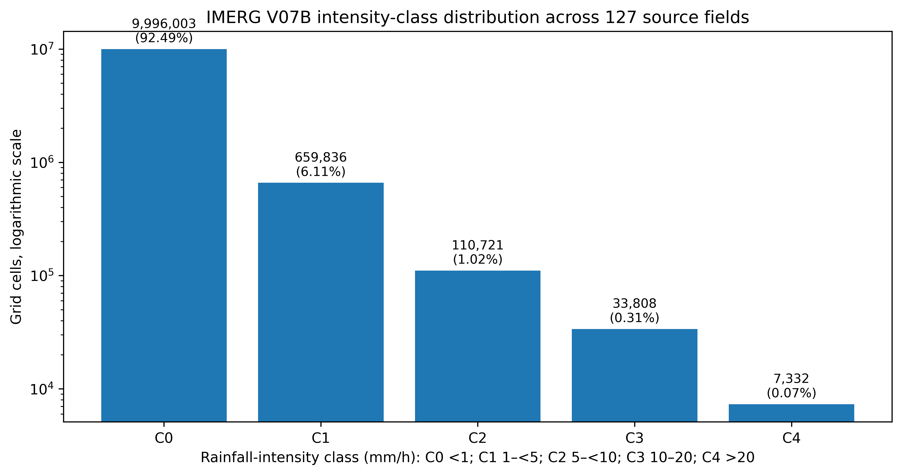

Evidence for Source characterization.

### Figure 5. Macro IoU across six architectures

Evidence for RQ1 / RQ3.

### Figure 6. Severe-rain CSI by architecture

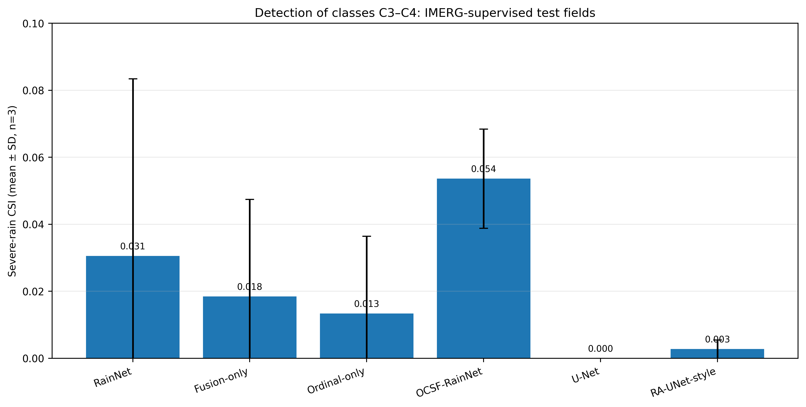

Evidence for RQ1 / RQ3.

### Figure 7. Variation across seeds 42 / 123 / 2025

Evidence for RQ3.

### Figure 8. Kaggle GPU graph-inference latency

Evidence for RQ3: computational cost.

### Figure 9. Held-out class-specific IoU C0–C4

Evidence for All RQs; severe-class limitation.

### Figure 10. All-class ordinal MAE from confusion matrices

Evidence for RQ2.

### Figure 11. Ordinal MAE conditional on true heavy/very-heavy labels

Evidence for RQ2.

### Figure 12. Per-seed Macro IoU deltas versus RainNet

Evidence for RQ1 / RQ2 / RQ3.

### Figure 13. Severe CSI across five held-out dates

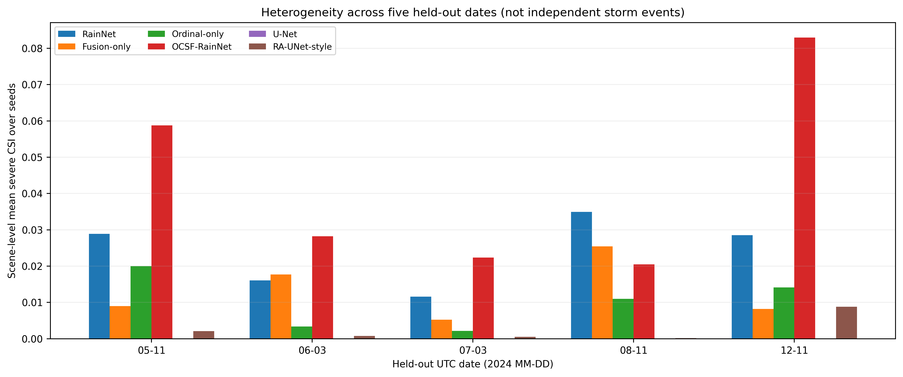

Evidence for All RQs; limited test dates.

## All 18 confusion matrices and 18 learning curves

All **36 archived experimental graphics** are shown in expandable galleries. Each is linked to its full-resolution file; corresponding per-run loss histories, confusion CSVs, test metrics and checkpoints remain available.

<strong>RainNet — 3 confusion matrices + 3 training curves</strong>

<table><thead><tr><th>Seed</th><th>Test confusion matrix</th><th>Training and validation curves</th></tr></thead><tbody>
<tr><td>42</td><td></td><td><a href='figures/results/learning_curves/plain_seed_42.png'>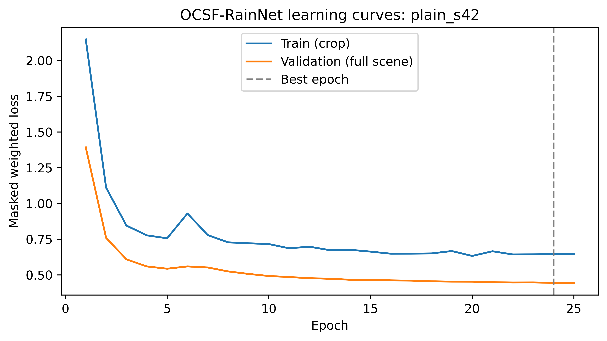</a></td></tr>
<tr><td>123</td><td></td><td><a href='figures/results/learning_curves/plain_seed_123.png'>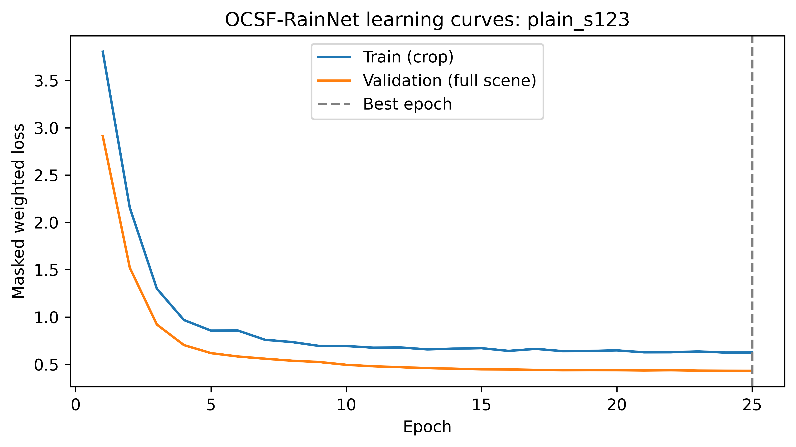</a></td></tr>
<tr><td>2025</td><td></td><td></td></tr>
</tbody></table>

<strong>Fusion-only — 3 confusion matrices + 3 training curves</strong>

<table><thead><tr><th>Seed</th><th>Test confusion matrix</th><th>Training and validation curves</th></tr></thead><tbody>
<tr><td>42</td><td></td><td><a href='figures/results/learning_curves/fusion_seed_42.png'>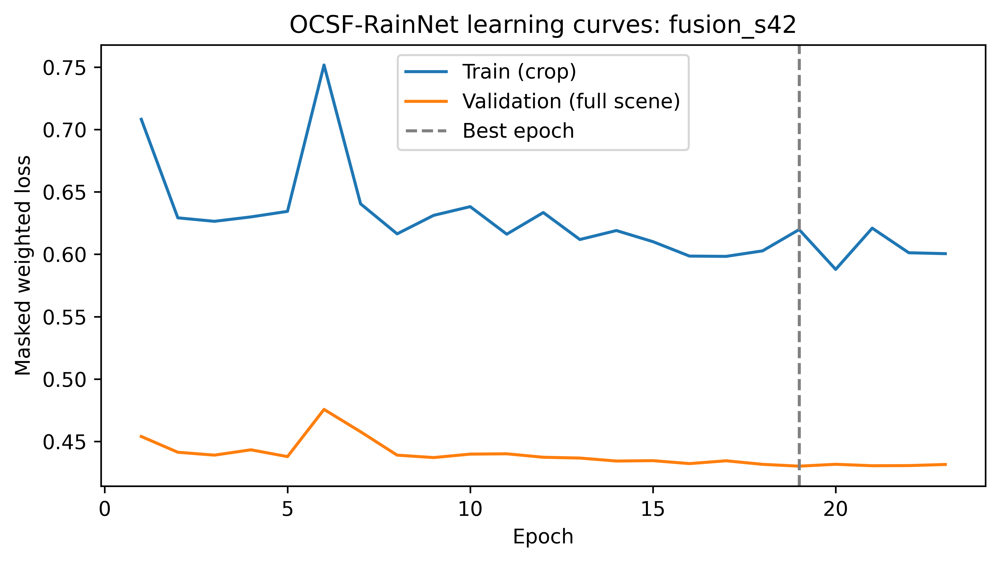</a></td></tr>
<tr><td>123</td><td><a href='figures/results/confusion/fusion_seed_123.png'>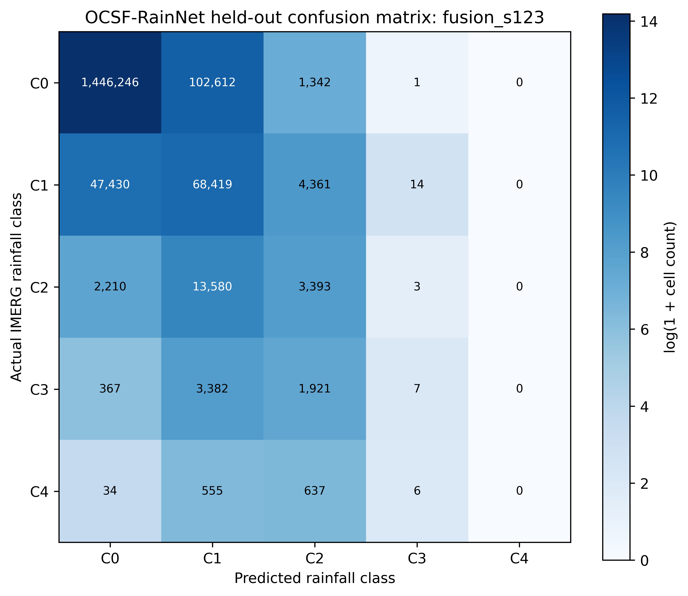</a></td><td></td></tr>
<tr><td>2025</td><td><a href='figures/results/confusion/fusion_seed_2025.png'>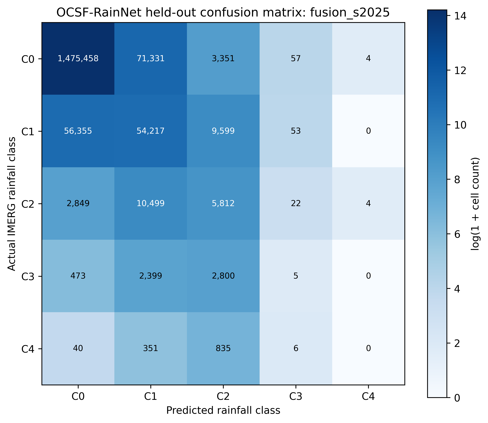</a></td><td><a href='figures/results/learning_curves/fusion_seed_2025.png'>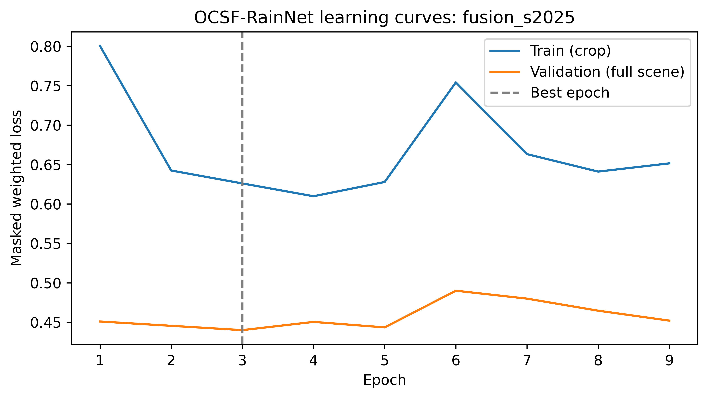</a></td></tr>
</tbody></table>

<strong>Ordinal-only — 3 confusion matrices + 3 training curves</strong>

<table><thead><tr><th>Seed</th><th>Test confusion matrix</th><th>Training and validation curves</th></tr></thead><tbody>
<tr><td>42</td><td></td><td><a href='figures/results/learning_curves/ordinal_seed_42.png'>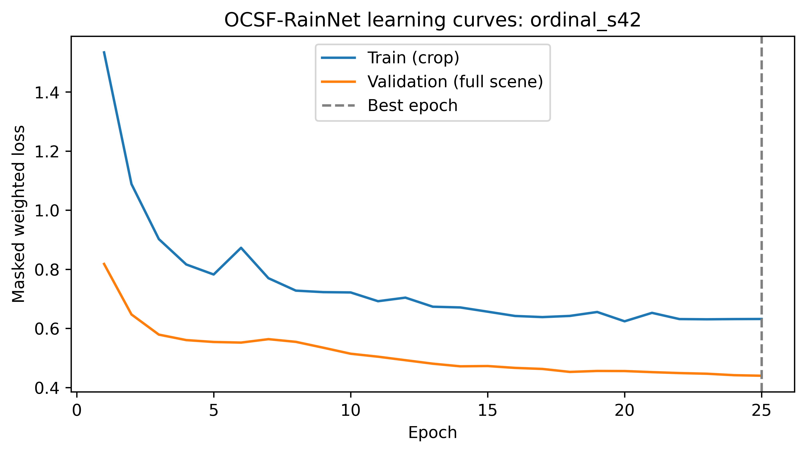</a></td></tr>
<tr><td>123</td><td></td><td></td></tr>
<tr><td>2025</td><td></td><td></td></tr>
</tbody></table>

<strong>OCSF-RainNet — 3 confusion matrices + 3 training curves</strong>

<table><thead><tr><th>Seed</th><th>Test confusion matrix</th><th>Training and validation curves</th></tr></thead><tbody>
<tr><td>42</td><td></td><td><a href='figures/results/learning_curves/proposed_seed_42.png'>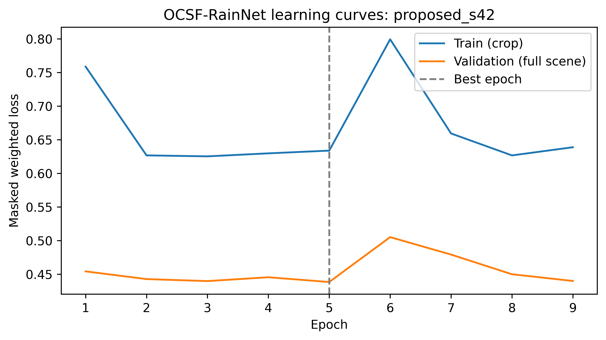</a></td></tr>
<tr><td>123</td><td></td><td></td></tr>
<tr><td>2025</td><td><a href='figures/results/confusion/proposed_seed_2025.png'>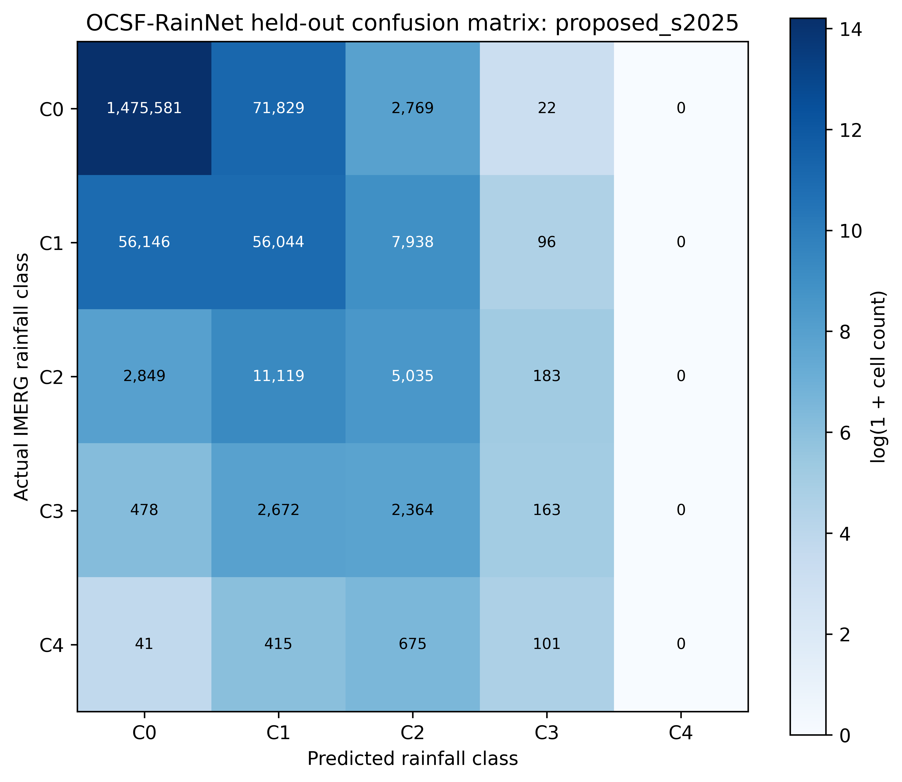</a></td><td></td></tr>
</tbody></table>

<strong>U-Net — 3 confusion matrices + 3 training curves</strong>

<table><thead><tr><th>Seed</th><th>Test confusion matrix</th><th>Training and validation curves</th></tr></thead><tbody>
<tr><td>42</td><td></td><td></td></tr>
<tr><td>123</td><td></td><td></td></tr>
<tr><td>2025</td><td></td><td><a href='figures/results/learning_curves/unet_seed_2025.png'>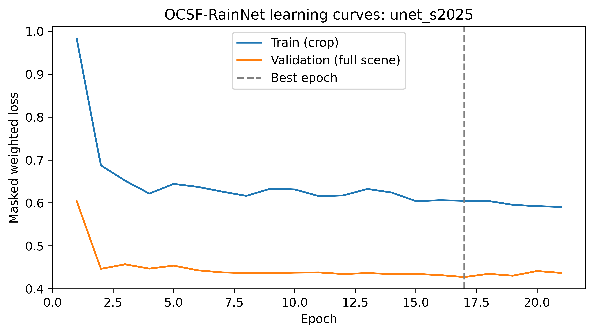</a></td></tr>
</tbody></table>

<strong>RA-UNet-style — 3 confusion matrices + 3 training curves</strong>

<table><thead><tr><th>Seed</th><th>Test confusion matrix</th><th>Training and validation curves</th></tr></thead><tbody>
<tr><td>42</td><td></td><td><a href='figures/results/learning_curves/raunet_seed_42.png'>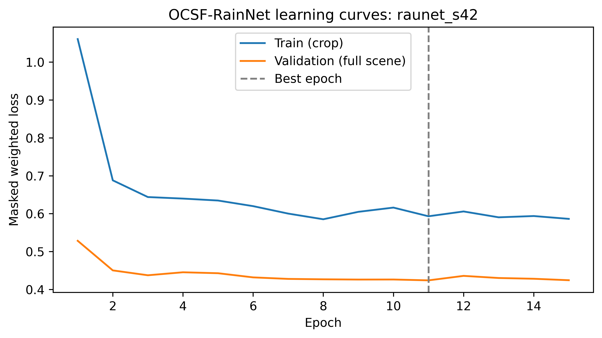</a></td></tr>
<tr><td>123</td><td></td><td><a href='figures/results/learning_curves/raunet_seed_123.png'>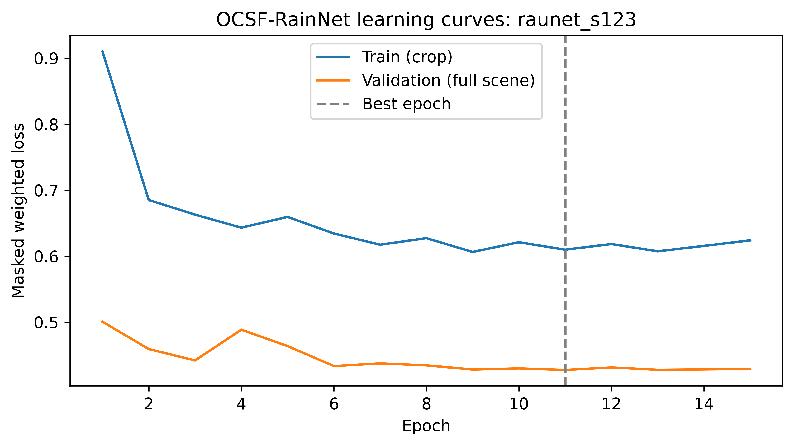</a></td></tr>
<tr><td>2025</td><td></td><td><a href='figures/results/learning_curves/raunet_seed_2025.png'>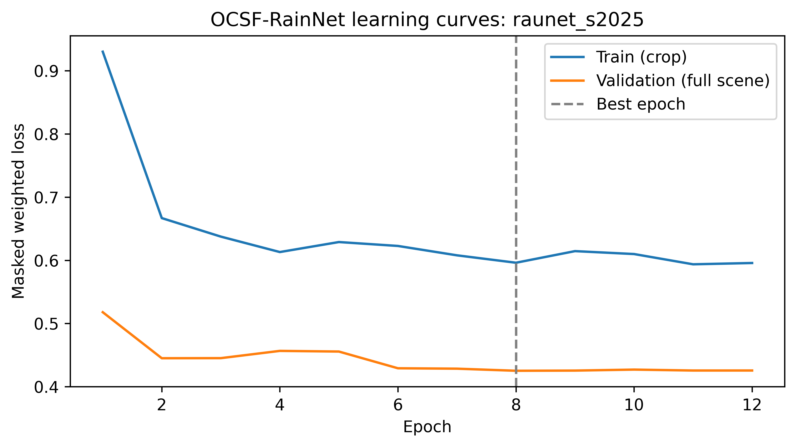</a></td></tr>
</tbody></table>

## Code, datasets, availability and journal status

- Actual experiment: 127 paired **calibrated Himawari-9 AHI B13 HSD brightness-temperature scenes** and NASA IMERG Final V07B supervision; 88 training / 19 validation / 20 test scenes, grouped by UTC date.
- Six variants, three seeds and checkpoints: [model source code](src), [Kaggle notebooks](notebooks/kaggle), [best/last checkpoints](checkpoints), [run-level test metrics](results/runs).
- [NASA IMERG Final V07B DOI](https://doi.org/10.5067/GPM/IMERG/3B-HH/07); [original RainNet study](https://doi.org/10.24507/icicel.18.04.313). The paired 2024 Kaggle dataset is private and raw source data/large prediction ZIPs are not distributed publicly.
- [Audited model results](metadata/18_run_independent_audit.json) · [dataset provenance](metadata/paired_scene_provenance.csv) · [experimental methodology](docs/REPRODUCE.md) · [figure/table index](docs/FIGURES_AND_TABLES_INDEX.md).
- [Archived draft DOCX](manuscript/archived_pre_experiment/OCSF-RainNet_pre_127_field_DRAFT.docx) preserves its original Mendeley fields. It **does not yet contain all completed results**; Methods, Discussion, Conclusion, Figures and tables must be reconciled before Springer submission.
- [Springer readiness checklist](docs/SPRINGER_SUBMISSION_STATUS.md) · [data/code availability](docs/DATA_AND_CODE_AVAILABILITY.md) · [attribution and rights](LICENSE_NOTICE.md).

**Scientific boundary:** Improvements in mean metrics are descriptive for five held-out UTC dates, not an independent BMKG validation or proof of independent meteorological events. C4 IoU remains close to zero; no loss-only ablation or operational alert certification has been performed.
