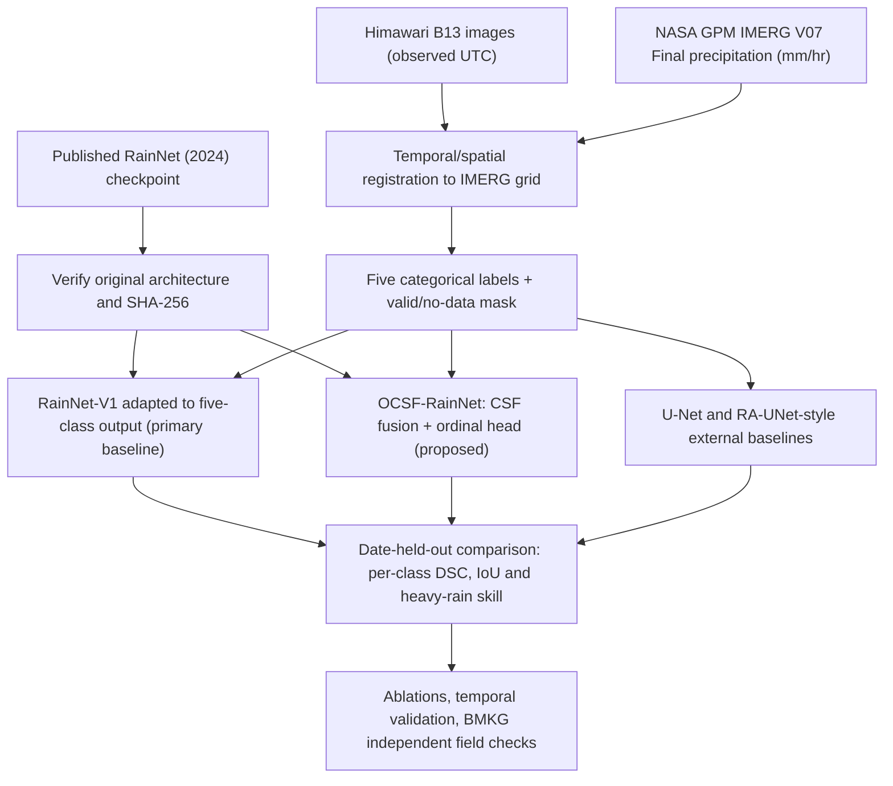

# OCSF-RainNet: Ordinal Cross-Scale Fusion for Himawari Rainfall-Intensity Segmentation

**Status:** proposed methodology with executable Python implementation, verified 2024 checkpoint and six architecture smoke tests. **Not an experimental result or an accepted publication.**

**Continuity with the published dissertation:**
Windarto, A. P., Yuhandri, Y., & Bukhori, S. (2024). A Novel Convective Cloud Segmentation for Heavy Rainfall Potential Assessment Using Deep Learning. *ICIC Express Letters*, **18**(4), 313–323. https://doi.org/10.24507/icicel.18.04.313

The 2024 RainNet is the direct **architectural foundation** and mandatory **primary reference baseline**. The original 2024 task predicted *binary convective-cloud masks for heavy-rainfall potential*. This proposal addresses a **new prediction target**: segmentation of categorical **estimated surface precipitation intensity** (0–4) from the numerical NASA GPM IMERG V07 field. No comparison can equate old binary cloud DSC directly with new five-class rainfall IoU.

## 2.1 Related Work

The original RainNet dissertation (Windarto et al., 2024) validated residual convolutional segmentation for regions associated with potential heavy rainfall, with a binary output. The locally preserved trained 2024 checkpoint, not a reconstructed model from memory, confirms four residual encoder stages of 4/8/16/32 filters, a 64-filter bridge, four residual decoder stages of 32/16/8/4, and a single-channel sigmoid head (142,617 parameters). The original architecture uses encoder–decoder skip pathways and projection residual connections. **Those backbone weights are reused**, while the head and cross-scale fusion are proposed additions.

U-Net and U-Net++ have been tested for satellite convection coverage forecasting from Himawari data (Monthly Weather Review, 2021, doi:10.1175/MWR-D-21-0096.1). Dugs-UNet introduces shape-aware segmentation and class-imbalance handling for geostationary severe-convection identification (Atmosphere, 2024, doi:10.3390/atmos15030243). Residual-Attention U-Net variants have been explored for Himawari rainfall nowcasting (Ji et al., Remote Sensing, 2024, doi:10.3390/rs16162871). A 2026 study uses U-Net fusion of satellite infrared and microwave precipitation estimates for rainfall analysis (doi and full methodology must be checked before citation in the final article). These prior works show that **attention, residual blocks and ordinal ideas individually are not presumed novel**.

The testable contribution of OCSF-RainNet is the explicit coupling of the *actual pretrained RainNet-2024 backbone*, **cross-scale gated skip fusion**, and a **monotonic cumulative severity segmentation head** for five estimated-rainfall categories. Its benefit must be validated by ablation relative to the same pretrained RainNet baseline.

## 2.2 Dataset and Supervision

Input: archived JMA Himawari B13 imagery, resampled to IMERG V07's approximately 0.1-degree grid at corresponding UTC observation periods. JMA SND and HRP products are **visual references/optional ancillary input candidates**, not rainfall-intensity truth. The archives currently hold 2,186 verified image/visualization artifacts, including 388 B13 images, 388 HRP images and 214 SND images, with repeated/derived products. They are not 2,186 independent aligned rainfall samples.

Supervision (pending): NASA GPM IMERG Final half-hourly V07, variable `Grid/precipitation` (mm/hr), aligned to satellite observations and geographic grid. This is a **multi-satellite estimated rate**, not independent ground-gauge truth. The CMR index for 20 September 2023 has 48 entries, but corresponding HDF5 labels have **not yet been downloaded**. Further days, diverse weather and severe-event sampling are necessary.

Operational classes defined from intensity `r` in mm/h (non-overlapping thresholds):
- `0`: `0 <= r < 1` — no / very light precipitation;
- `1`: `1 <= r < 5` — light;
- `2`: `5 <= r < 10` — moderate;
- `3`: `10 <= r <= 20` — heavy;
- `4`: `r > 20` — very heavy;
- `255`: missing/invalid input, excluded from loss and metrics.

These are operational bins derived from the 2024 BMKG circular for light, moderate and heavy ranges and BMKG meteorological bulletins for the >20 mm/h category. The below-1 mm/h bin **must not be described as strictly zero rainfall**.

**Temporal leakage:** 2023 Himawari images that appeared in historical RainNet research must not be counted as an independent new test of pretrained model generalization. Use 2023-09-20 initially for pilot/source matching. An independent evaluation must hold out new dates/events or regions not used for either RainNet pretraining or new fine-tuning, where provenance allows.

## 2.3 Research Framework

*Figure 2 (planned). Research workflow distinguishes the original RainNet backbone and the proposed extensions and uses identical verified IMERG masks across all new-task comparisons.*

## 2.4 Proposed Method: Ordinal Cross-Scale Fusion RainNet (OCSF-RainNet)

### 2.4.1 Checkpoint-preserving residual backbone

Load the SHA-256-verified copy of the original trained 2024 RainNet model from `SEGMENTASI_HUJAN/models/pretrained_rainnet_2024/rainnet_binary_best_05.h5` (identical to the source file in `PROGRAM_RAINNET/models/selected/`). Check its input/output dimensions, block order, filter widths, parameter count, and SHA-256. Reuse the original encoder, bridge and decoder **layers and their weights**, not weights imported from a different U-Net architecture. The binary output head is removed only in the new derivative model. The input graph is re-expressed with variable spatial dimensions **divisible by 16** to match 4 pooling levels, while preserving the same convolutional kernels and BN parameters.

Original encoder skip features `S_0`, `S_1`, and `S_2` represent full, half and quarter input grid resolution. Let `D` be the final decoded feature map.

### 2.4.2 Proposed context-gated cross-scale skip fusion (CSF)

`F = Concat(Conv1x1(S_0), Up_2(Conv1x1(S_1)), Up_4(Conv1x1(S_2)), Conv3x3(D))`.

Spatial attention `A = sigmoid(Conv3x3(F))`.

Fused feature `H = A ⊙ ReLU(Conv3x3(F)) + Conv1x1(D)`.

This adds a learned spatial gate and residual preservation of original decoded features. The added layers **do not replace the old RainNet encoders**.

### 2.4.3 Proposed ordinal exceedance segmentation head

The five rainfall categories have a natural severity order. Instead of an unconstrained five-channel softmax, predict four ordered exceedance probabilities.

Let a 1×1 convolution over `H` produce `z_1` and `g_2, g_3, g_4`. Define

`z_k = z_1 - sum_{j=2}^{k} softplus(g_j),  k=2,...,4`;

`q_k = sigmoid(z_k) = P(Y >= k)` for `k=1,...,4`.

Because each softplus term is nonnegative, `q_1 >= q_2 >= q_3 >= q_4`. The final categorical distribution is

`p_0 = 1-q_1`,
`p_1 = q_1-q_2`,
`p_2 = q_2-q_3`,
`p_3 = q_3-q_4`,
`p_4 = q_4`.

All `p_k` are nonnegative and sum to one (up to floating-point tolerance). This enforces **severity-order consistency per pixel**, not spatial continuity or a monotonic weather field. Original architecture and checkpoint remain directly recognizable.

### 2.4.4 Masked class-balanced learning

For valid pixels `V`, define

`L = [ sum_{i in V} w_{y_i} CE(y_i, p_i) ]/[sum_{i in V} w_{y_i}] + lambda * [ sum_{i in V} |E_p[Y_i]-y_i|/4 ]/|V|`.

Weights `w_c` are derived **only from training dates**, using capped square-root inverse frequency. Initial `lambda=0.12` is a **pilot hyperparameter**, not previously verified optimal; choose it on the validation split. Target 255 is excluded.

Two-stage transfer learning (pilot): freeze original residual blocks for up to 5 epochs, train the new head, then unfreeze and fine-tune for up to 20 epochs with lower learning rate. Baselines use the same total epoch budget and split, while pretraining differences are explicitly documented.

## 2.5 Comparative Methods and Ablations

| Identifier | Architecture | Source/role | Actual implementation |
|---|---|---|---|
| B1 | U-Net, five-class | External published architecture baseline | Faithful U-shape pattern, independently implemented |
| B2 | Residual attention U-Net style, five-class | Inspired by RA-UNet Himawari rainfall literature | **Not claimed exact author-code replication** |
| B3 | **RainNet 2024 + five-class softmax** | **Primary parent-model baseline** | **Authentic 2024 checkpoint**, no new fusion |
| A1 | RainNet + CSF + five-class softmax | Fusion ablation | Same 2024 checkpoint |
| A2 | RainNet + ordinal head, no CSF | Ordinality ablation | Same 2024 checkpoint |
| P | **OCSF-RainNet** (CSF + ordinal) | **Proposed method** | Same 2024 checkpoint |

The RainNet V1 original **binary** checkpoint evaluation on historical cloud masks remains contextual prior evidence, **not** directly mixed into the multiclass benchmark table.

## 2.6 Evaluation Plan (not yet results)

- Dataset: at least 10 independent UTC dates and at least 40 true IMERG-aligned cases for a *pilot*. This threshold is not sufficient for a strong final paper without wider weather, region and event coverage.
- Validation/test: grouped by UTC date/meteorological event; no adjacent frames separated at random; historical pretraining dates must be flagged.
- Multiclass: per-class IoU, Dice/F1, mean IoU, confusion matrix, macro F1, severe-rain recall and false alarm statistics.
- Computational: params, memory, CPU/GPU latency, and training time with same hardware and batch size.
- Statistics: multiple seeds `[42,123,2025]`; bootstrap by **day/event**, not individual pixels.
- External reference: independent BMKG radar and/or ARG/AWS measurements where data permissions allow. If absent, claim only **agreement with IMERG estimates**, not independently validated measured rainfall.
- Diagnostic split: hold out heavy-rain events and domain/season shift if a sufficient dataset becomes available.
- Compare proposed P against B3 to isolate **architectural extension** from the change of binary versus multiclass task.
- Do not claim nowcasting / future precipitation until explicit future labels and a temporal prediction model exist.

### Implementation

1. `04_Proposed_OCSF_RainNet.ipynb`: inspect true checkpoint, architecture diagram, forward pass, ordinal monotonicity, ablation parameter counts.
2. `05_Comparative_Experiments_and_Ablations.ipynb`: baselines, quality gates, temporal split, train-only weights, evaluation code, guarded training.
3. `scripts/rainnet_intensity_models.py`: executable proposed model + all baselines.
4. `scripts/smoke_proposed_method.py`: no-data/no-training inspection of 6 model variants.

### Validated reference links

- Windarto et al. (2024), original RainNet article: https://doi.org/10.24507/icicel.18.04.313
- U-Net Himawari convection comparison (2021): https://doi.org/10.1175/MWR-D-21-0096.1
- Dugs-UNet (2024): https://doi.org/10.3390/atmos15030243
- Ji et al. RA-UNet oceanic rainfall (2024): https://doi.org/10.3390/rs16162871
- NASA IMERG V07 documentation: https://gpm.nasa.gov/resources/documents/imerg-v07-technical-documentation
- NASA IMERG V07 FAQ (unit `Grid/precipitation` mm/hr): https://gpm.nasa.gov/sites/default/files/2025-02/FAQ%20for%20IMERG%20V07%20Applications%20Users_202502.pdf
- BMKG circular, 10 December 2024: https://jdih.bmkg.go.id/dokumen/detail/4512
- BMKG bulletin intensity including very heavy category: https://bbmkg3.bmkg.go.id/public_data/buletin/Buletin_BBMKG3_052025.pdf

**No training accuracy, statistics, results or conclusions have been fabricated.**
